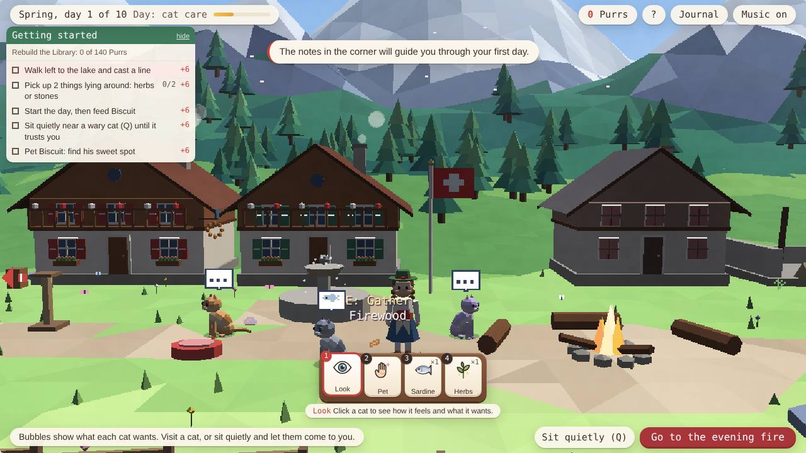
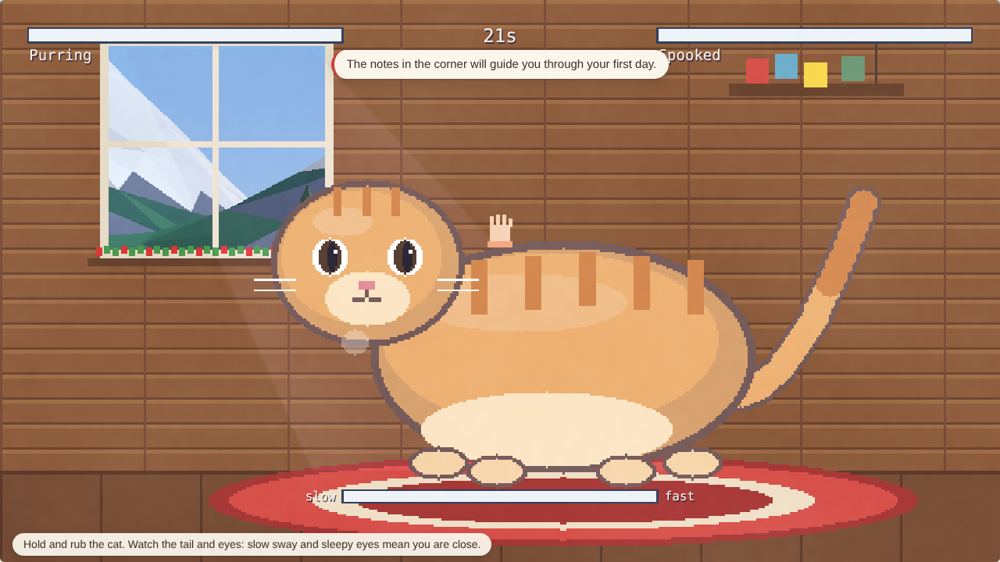
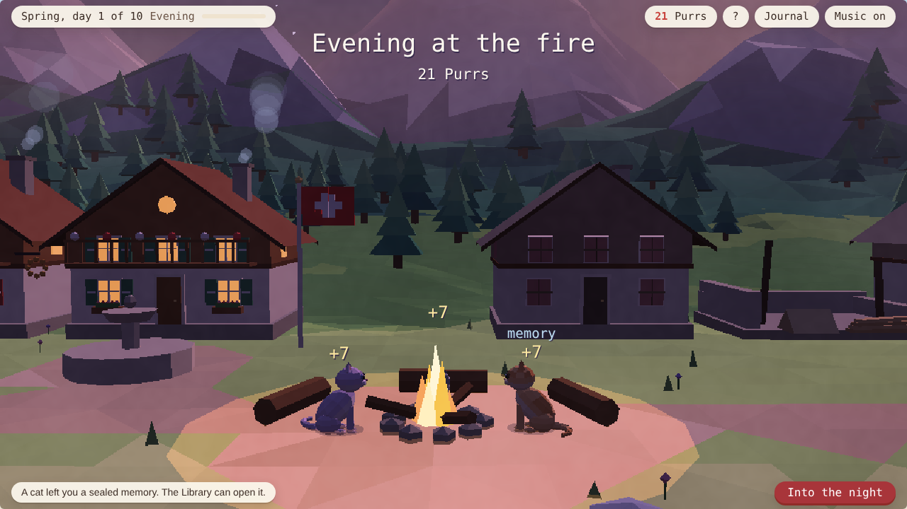
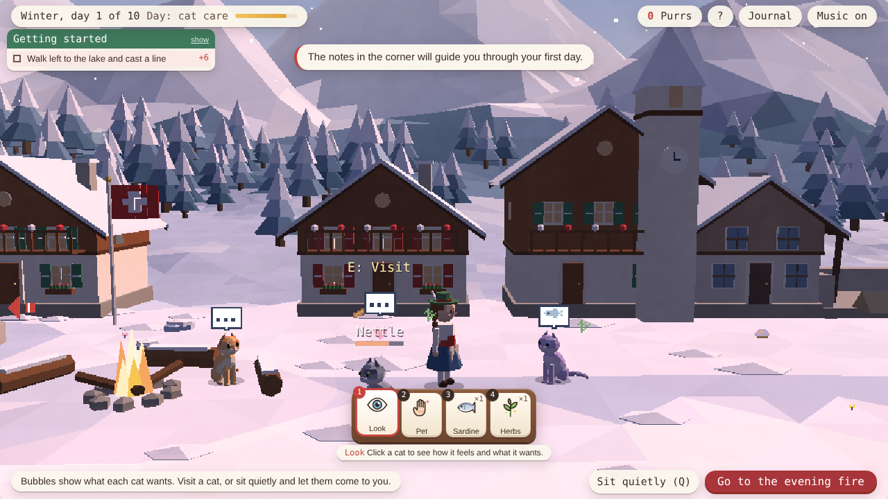

# Purrlight

A cozy low-poly 3D village sim about winning over the wary cats of an abandoned Alpine village.
Forage at dawn, care for the cats by day, gather at the fire in the evening, and rebuild the
village at night, until you can relight the Great Lantern.



**Everything is generated in code**: a small WebGL 2 engine written from scratch, the valley,
chalets and cats built from code as low-poly meshes, and a generative soundtrack that never
loops. No three.js, no models, no textures: about 12,000 lines of dependency-free JavaScript that
build into a single ~400 KB HTML file.

## Highlights

- **Four seasons** that change the rules: skittish spring cats, summer shade, autumn hunts, and
  winter nights where you split the cats between fires.
- **Eight cats with hidden personalities**: each has secret favourite foods, a favourite toy and
  a sweet spot you discover by playing.
- **Five minigames**: rhythm fishing, petting (find the sweet spot by reading the tail and eyes),
  laser pointer, ribbon wand and yarn ball, plus autumn mouse hunts.
- **Guided progression**: a first-day tutorial, three daily notes with rewards, cat wishes, bond
  tiers that unlock new interactions, and a story told through 40 memory letters.
- **Care in the world, not in menus**: a tool bar lets you stroke a cat by holding it, or
  feed it by clicking it with food. Friendly cats rub against your legs, groom, yawn and chase
  butterflies.
- **A hand-written 3D renderer**: flat-shaded meshes with soft two-band lighting, fog, a sky
  with sun, moon and stars, animated water, glass, glowing windows at night, and four lighting
  presets blended through the day. Cats are little rigs with coat patterns, poses and hats.
- **Generative music**: a chord walk drives piano, guitar, music box and a distant alphorn, with
  birdsong and cowbells underneath.

| Petting                                  | Evening at the fire                      | Winter                                 |
| ---------------------------------------- | ---------------------------------------- | -------------------------------------- |
|  |  |  |

## Play

```sh
npm run dev        # serves the folder; open http://localhost:5173
```

No build is needed to play: `index.html` loads the source as native ES modules.
To produce the single-file version, run `npm run build` and open `dist/index.html`.

| Action                   | Keyboard           | Mouse or touch            |
| ------------------------ | ------------------ | ------------------------- |
| Walk                     | WASD or arrow keys | Click or tap where to go  |
| Use, visit, gather       | E                  | Click or tap the thing    |
| Sit quietly              | Q                  | "Sit quietly" button      |
| Journal                  | J                  | "Journal" button          |
| Fishing lanes            | A, S, D            | Tap the lanes             |
| Pick a tool              | 1-7                | Tool bar at the bottom    |
| Stroke a cat (hand tool) | Hold E             | Press and hold on the cat |
| How to play              | H                  | "?" button                |

## Develop

Requires Node 20 or later.

```sh
npm install
npm test           # unit tests (node:test, no browser needed)
npm run test:e2e   # builds, then plays the game in headless Chromium
npm run check      # lint, formatting, type check and unit tests
npm run build      # writes dist/index.html
node tools/simulate.js   # balance report: when a simulated player reaches each milestone
```

The first `npm install` creates `package-lock.json`; commit it so CI can use `npm ci`.

## Project structure

```
src/
  data/      cats, foods, buildings, story text (frozen, no logic)
  core/      game rules as pure functions, fully unit-tested
  engine/    canvas primitives, the WebGL 2 renderer (engine/gl), generative audio, input
  render/    the 3D valley, village and character models, lighting, sprites, particles
  game/      runtime state, actions, event bus, saving, session flow
  scenes/    the village and each minigame
  ui/        HTML menus, HUD and the notes panel
  main.js    entry point and frame loop
tests/
  unit/      rules, save migration, data integrity, architecture rules
  e2e/       browser smoke test of the first day
tools/       a ~100-line bundler, the build script and the balance simulator
```

Read [docs/ARCHITECTURE.md](docs/ARCHITECTURE.md) for how the layers fit together and why.

## Engineering notes

- **Testable rules.** All game logic lives in `src/core/` as pure functions over a plain JSON
  state, with an injectable random generator. 107 unit tests cover feeding,
  petting and fishing scoring, daily notes, seasons, winter fires, the shop, save migration,
  the 3D maths and the valley's geometry.
- **A balance simulator.** `tools/simulate.js` plays whole journeys with the real rules in
  seconds. It showed that an earlier tuning could be finished in 11 days instead of 40, which led
  to the current numbers; balance tests now keep the pacing within bounds.
- **Enforced layering.** A test fails if a low-level module imports a higher one, and ESLint
  keeps browser APIs out of the rules.
- **Typed without a compile step.** JSDoc types are checked with `tsc --checkJs`.
- **Decoupled progress.** Actions publish events; goals and wishes subscribe to them.
- **A small 3D engine.** `src/engine/gl/` is about 1,000 lines: matrix maths, a CPU mesh builder
  (boxes, cylinders, spheres, gable roofs, terrain), GLSL shaders and a renderer with a
  transparent pass, particles, screen projection and offscreen snapshots for menu portraits.
  The geometry and maths are pure and unit-tested.
- **2D logic, 3D view.** Game rules keep simple 2D map coordinates; `render/space.js` maps
  them onto the terrain. Clicks are resolved by ray-marching the view ray against the
  terrain, and labels, bubbles and markers are projected from 3D onto a crisp pixel HUD.
- **Meshes are built once.** The valley is rebuilt when the season changes and the village only
  when something is built, so each frame is a few dozen draw calls.
- **Save migrations.** Old saves upgrade to the current format; corrupt saves are ignored safely.
- **No dependencies at runtime or build time.** The custom bundler checks imports and name
  collisions; dev tools (ESLint, Prettier, TypeScript, Playwright) are only for checks.

## Licence

MIT. All art, music and text are original and generated by the code in this repository.
