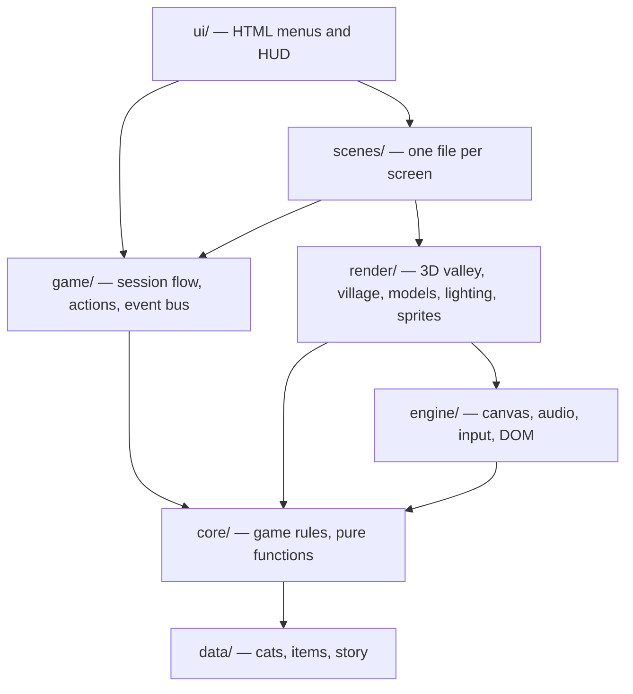

# Architecture

Purrlight is a browser game written in plain JavaScript modules with no runtime dependencies.
It draws a low-poly 3D valley with its own small WebGL 2 renderer, puts a crisp 480×270 pixel
HUD on top, and generates all of its music with the Web Audio API. This document explains how the code is organised and why.

## Layers



Each layer may only import from layers below it. `tests/unit/architecture.test.js` enforces
this, and ESLint forbids browser globals inside `core/` and `data/`.

| Layer     | Responsibility                                                                   | Knows about the DOM? |
| --------- | -------------------------------------------------------------------------------- | -------------------- |
| `data/`   | Static content: cats, foods, buildings, story text. Frozen objects only.         | No                   |
| `core/`   | Game rules as pure functions over a plain `GameState` object.                    | No                   |
| `engine/` | Browser primitives: canvas helpers, the WebGL 2 renderer, audio, input.          | Yes                  |
| `render/` | Drawing: the 3D world, models, lighting, sprites. Reads state, never changes it. | Yes                  |
| `game/`   | Runtime (positions, camera), actions, the event bus, saving, session flow.       | Yes                  |
| `scenes/` | The village and each minigame: `enter`, `update(dt)`, `draw()`.                  | Yes                  |
| `ui/`     | HTML menus, the HUD and the notes panel.                                         | Yes                  |

## Two kinds of state

- **`GameState`** (`core/state.js`) is everything that is saved: warmth, bonds, the bag, what
  has been built. It is plain JSON, typed with JSDoc and checked by `tsc --checkJs`.
- **Runtime state** (`game/runtime.js`) is everything that is not saved: where the cats are
  standing, the camera, particles, what the player is looking at.

Keeping them apart makes saving trivial (`JSON.stringify`) and keeps the rules testable without
a canvas.

## Rules are pure functions

Every rule in `core/` takes the state (and, where randomness is involved, an `rng` function)
and returns a result:

```js
const result = feedCat(state, 'biscuit', 'milk');
// { ok: true, taste: 'love', warmth: 29, discoveredFavourite: true }
```

Tests pass a seeded generator (`createRng(seed)`) so outcomes are repeatable. The two
skill-based minigames, fishing and petting, are written as small state machines
(`createFishingSession` / `pressLane` / `stepFishing`), so their scoring is tested too.

## Events decouple actions from progress

Player actions (`game/actions.js`) apply a rule, play a sound and publish an event on the bus
(`game/bus.js`), for example `cat:fed` or `fishing:catch`. Subscribers in `game/progress.js`
turn events into progress: daily notes, cat wishes and rewards. Adding a new kind of goal means
adding a subscriber, not editing every action.

## Rendering

Three canvases are stacked in `#stage`:

1. `#world3d`: WebGL 2, rendered at 960×540 and shown with crisp pixels.
2. `#pixels`: a transparent 480×270 HUD for bubbles, hearts, items and markers.
3. `#overlay`: full-resolution text.

**The engine** (`engine/gl/`) knows nothing about the game:

- `math3d.js`: column-major matrices, projection, look-at and inversion.
- `geometry.js`: a `MeshBuilder` that makes flat-shaded triangles with per-face normals and
  vertex colours, from boxes, cylinders, cones, spheres, gable roofs and height-field terrain.
- `shaders.js`: lit meshes with soft two-band cel lighting, hemisphere ambient, fog, optional
  water waves and a specular/fresnel "shine"; a procedural sky with sun, moon and stars; and
  round particles sized in metres.
- `renderer.js`: uploads meshes, draws opaque meshes, then sorts transparent ones back to front,
  then draws particles. It also projects points to the screen, unprojects clicks into rays, and
  renders offscreen snapshots (used for the cat portraits in menus).

**The world** (`render/`) builds meshes from game data:

- `space.js`: maps game coordinates to metres and defines the ground's height (flat street,
  hills, a ring of peaks, the lake basin, the Lantern's knoll). It is pure and deterministic.
- `valley.js`: terrain, forest, meadow details, lake and clouds, rebuilt once per season.
- `village3d.js`: chalets, ruins and rebuilt buildings, the Lantern tower and the props. It is
  rebuilt only when something is built or bought, and it returns chimney tops for smoke.
- `models.js`: cats, the player and the goat as rigs of unit meshes. Each part gets its own
  transform per frame, so poses animate without rebuilding geometry. Models draw through a
  tiny `Painter` interface, which unit tests replace with a mock.
- `lighting.js`: dawn, day, dusk and night presets, blended by the day's clock.
- `stage.js`: owns the renderer, keeps the meshes current, frames cameras, and converts between
  game coordinates and the screen.

**Game logic stays 2D.** The rules and runtime use the original map coordinates: x along the
street, y for depth. `render/space.js` maps them onto the terrain, so movement and collisions
did not change when the game became 3D. Clicks are resolved in two steps. Characters and items
are hit-tested where they appear on screen. Anything else goes to `groundUnder`, which
ray-marches the view ray against the height field to find the ground point.

## Saving

`core/save.js` serialises and migrates saves; `game/persistence.js` stores them. A corrupt or
unknown save loads as `null` instead of crashing. Version 2 saves (from before this refactor,
with short field names) are migrated field by field, and a unit test covers that migration.
When the game runs as a Claude artifact with a signed-in viewer, saves are also mirrored to a
private per-user document.

## Build

There is no bundler dependency. `tools/bundler.js` (about 100 lines) concatenates the modules
in dependency order into one function scope and inlines it, with the CSS, into a single HTML
file. It supports only the module syntax the project uses and checks that:

- every imported name is exported by its module, and
- no two modules declare the same top-level name (they share one scope after bundling).

During development, `index.html` loads `src/main.js` as native ES modules, so no build step is
needed to play.

## Testing

| Suite      | What it covers                                                                                                 | Command            |
| ---------- | -------------------------------------------------------------------------------------------------------------- | ------------------ |
| Unit       | Every rule in `core/`, data integrity, save migration, layering, bundling, balance                             | `npm test`         |
| End-to-end | Plays the built game in Chromium: the first day, the tool bar, 3D clicks, saving and reloading, a phone screen | `npm run test:e2e` |
| Static     | ESLint, Prettier, `tsc --checkJs` on `core/`, `data/` and the pure 3D modules                                  | `npm run check`    |

## Balance

`tools/simulate.js` is a bot that plays whole journeys using only `core/`: it forages, fishes,
feeds each cat its best food, coaxes wary cats, pets and plays within each day's time budget,
and spends Purrs at night. Running it over many seeds gives the median day each milestone is
reached. An earlier tuning finished in 11 days and never reached summer; the current numbers put
the Lantern at around day 30 of 40 for a diligent player, and `tests/unit/balance.test.js` fails
if a change moves that outside sensible bounds.

All tuning numbers live in `src/config.js` (`BALANCE`) and the data files. Short journeys use one
pace multiplier (`shortJourneyPace`) for both Purrs and bond.

## Trade-offs

- **Plain JavaScript with JSDoc** instead of TypeScript keeps the zero-build development loop;
  the core is still type-checked.
- **A singleton runtime object** (`game`) is simple and fits a single-player game loop. The
  rules never touch it, which is what keeps them testable.
- **A custom renderer instead of three.js** keeps the single file small and dependency-free and
  shows the fundamentals, at the cost of features a library would give for free (shadow maps,
  skinned animation). Blob shadows and part rigs are enough for this art style.
- **Procedural art and audio** keep the game to one ~400 KB file with no assets to license, at
  the cost of a short pause (about 0.2 s) to rebuild meshes when the season changes.
- **2D sprites remain** for the petting close-up and the pixel icons, and as menu portraits if
  WebGL 2 is unavailable.
